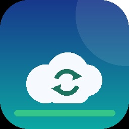

# Switch Cloud Sync

**[中文](README.md)** | [English](README.en.md)

> Back up your Switch **save data**, **album screenshots/videos** and **play activity** to your own server — and restore saves from it.
>
> Graphical UI · ZIP compression · incremental deduplication · detailed play events · Chinese/English · built-in admin panel




---

## Contents

- [Features](#features)
- [Requirements](#requirements)
- [Quick start](#quick-start)
- [Using the Switch app](#using-the-switch-app)
- [Admin panel](#admin-panel)
- [Deduplication and compression](#deduplication-and-compression)
- [Configuration](#configuration)
- [Building](#building)
- [Project layout](#project-layout)
- [FAQ](#faq)
- [Disclaimer](#disclaimer)

---

## Features

| Feature | Details |
| --- | --- |
| Save backup | Packed into a standard ZIP (deflate); you can open it on a PC |
| Save restore | Pick a timestamp on the server, verify it, write it back |
| Changes only | Save-data `commit_id` pre-check + ZIP SHA-256 confirmation; unchanged saves are skipped |
| Album backup | Screenshots/videos uploaded incrementally by `path + size + mtime` |
| Play activity | Summary (per game × user) + detailed events (launch/exit/focus/account switch) |
| Admin panel | Devices, saves with history, album preview, playtime charts, event charts |
| First-run wizard | Shows the API URL and a short token, waits for the client, then creates the admin |
| Bilingual | Follows the system language, or switch 中文 / English in Settings |

---

## Requirements

1. A Switch running **Atmosphère**, able to launch homebrew from hbmenu
2. A PC (Windows / Linux / macOS) to run the server
3. Both on the **same LAN / Wi-Fi**

The server only needs **Python 3.10+** and has no third-party dependencies.

---

## Quick start

### 1. Start the server (PC)

```bash
python server/switchcloud_server.py --host 0.0.0.0 --port 8420
```

On Windows you can also double-click `server/start.bat`.

The terminal prints the admin page and the access token, for example:

```
Admin page : http://127.0.0.1:8420/
API base   : http://192.168.1.10:8420
Token      : K7M2-9QX4
```

### 2. Open the admin page

Open **`http://192.168.1.10:8420/`** in a browser (use your PC's LAN IP).

On first run you get the setup wizard, which shows:

- **API base URL** to enter on the Switch
- **Access token** — a short token like `K7M2-9QX4`. **Case-insensitive, dashes optional**
- Status: waiting for the client…

> Do not give the Switch `127.0.0.1` — it cannot reach your PC's loopback address.

### 3. Install the Switch app

1. Download `switch-cloud-sync.nro` (Releases, or the GitHub Actions artifact)
2. Copy it to `sd:/switch/switch-cloud-sync.nro`
3. Launch it from hbmenu (holding `R` while launching a game gives full-memory mode)

### 4. Connect the two sides

1. In the app open **Settings**
2. Enter:
   - Server URL: `http://192.168.1.10:8420`
   - Access token: the token from the wizard
3. Save, then tap **Test server connection**
4. The wizard on the PC flips to "client detected" and unlocks the admin form

### 5. Create the admin account

Set a username and password in step 3 of the wizard; you are logged in automatically.

### 6. Upload

Tap **"Upload everything"** on the app's home screen:

- Saves → Album → Play activity
- A summary shows uploaded / skipped / failed
- The second run mostly shows "skipped (unchanged)"

---

## Using the Switch app

Home screen buttons:

| Button | Action |
| --- | --- |
| Upload everything | Saves + album + play activity |
| Upload saves | Only changed saves |
| Restore saves | List server backups and write one back |
| Upload album | New/changed screenshots and videos |
| Upload play activity | Summary + detailed events |
| Settings | Server, token, language, sync options |
| Exit | Back to hbmenu |

Controls:

| Button | Action |
| --- | --- |
| `↑ ↓ ← →` | Move |
| `A` | Select / edit |
| `B` | Back / cancel a transfer |
| `X` (Settings) | Save |
| `Y` (Settings) | Reload config |
| `+` | Exit |

Press `B` during a transfer to cancel. Logs are written to `sd:/switch/cloud-sync/logs/sync.log`.

### Language

**Language** in Settings:

- `Auto` — follow the Switch system language (Chinese system → Chinese, otherwise English)
- `Chinese` / `English` — force one

---

## Admin panel

| Page | Contents |
| --- | --- |
| Overview | Devices, saves/size, album/size, total play time, recent uploads, top games |
| Devices | IP, client version, first/last seen per device |
| Saves | Per game, with version history and ZIP downloads |
| Album | Image thumbnails, in-browser video playback, browse by date, download |
| Playtime | **Top-15 bar chart**, per-user bar chart, full table |
| Play events | **Totals per user / per game / event-type bar charts**, per-game launch/exit events and a **last-14-days bar chart** |
| Settings | Show/copy API URL and token, reset the token, change the admin password |

All data lives in `server/data/` (SQLite + files); back up that folder.

---

## Deduplication and compression

**Saves**

1. Read the save-data `commit_id`; if it matches the last upload → skip (the save is not even mounted)
2. Otherwise build a ZIP and compare its SHA-256 with the stored one → skip if identical
3. Upload only when the content really changed

**Album**

Compared by `path + size + mtime`; unchanged files are not uploaded. Local files are kept by default.

**New server**

The client remembers the server instance ID. If the server database is recreated (or you switch backends), the next upload rebuilds the local index and uploads once in full instead of wrongly skipping.

---

## Configuration

Use the in-app Settings, or edit `sd:/switch/cloud-sync/config.ini`:

```ini
[server]
base_url = http://192.168.1.10:8420
token = K7M2-9QX4
ca_bundle =
insecure_tls = 0
timeout_sec = 60

[device]
id =
name = my-switch

[saves]
enabled = 1
games_only = 1
max_upload_mb = 256

[sync]
only_changed = 1

[album]
enabled = 1
delete_after_upload = 0

[playtime]
enabled = 1
detailed = 1

[app]
language = auto
```

- `base_url` must not end with `/`
- Self-signed HTTPS: put the PEM at `sd:/switch/cloud-sync/ca-bundle.pem`
- `only_changed = 0` forces a full upload
- The per-save limit applies to the **compressed** size

---

## Building

Requires devkitPro (devkitA64 + libnx), `switch-curl`, `switch-freetype`, `switch-harfbuzz`, `switch-zlib`:

```bash
pacman -S --needed switch-dev switch-curl switch-freetype switch-harfbuzz switch-zlib
make -j$(nproc)
```

Output: `switch-cloud-sync.nro` (the icon in `icon.jpg` is embedded automatically).

You can also use the bundled GitHub Actions workflow and download the artifact.

---

## Project layout

```
Makefile / icon.jpg
include/               # C++ headers (UI, sync, i18n, network, saves…)
source/                # implementations
server/                # self-hosted server (Python stdlib)
  switchcloud_server.py
  store.py
  webui.py
  start.bat
  README.md
tools/
  dev_server.py        # minimal API-only dev server
  dev_smoke_test.py    # API smoke test
  make_icon.py         # icon generator
docs/
  API.md               # server protocol (for your own backend)
  INSTALL.md           # build / install
  TROUBLESHOOTING.md   # troubleshooting
```

---

## FAQ

**The wizard keeps waiting for the client.**
Make sure the app uses the PC's **LAN IP** (not 127.0.0.1), the same port, and that the Windows firewall allows inbound Python connections.

**Uploads are slow.**
Saves are compressed first — the log shows `compressed A -> B`. Album videos are usually uploaded as-is, so the first run takes a while.

**Where does play time come from?**
From the system Play Log (`pdm:qry`), the same source as the console's profile page. It is a ring buffer; old records get overwritten.

**The game does not see the restored save.**
The game must be started **after** the restore, and must be fully closed before it. Keep history on the server.

**A specific game fails to back up.**
Send that line from `sd:/switch/cloud-sync/logs/sync.log` to Issues. It contains the path, entry type and error codes; concatenation files are already handled.

**Can I expose it to the internet?**
Yes, but put it behind an HTTPS reverse proxy and use a longer token: `--token-length 24`.
See [server/README.md](server/README.md).

More: [docs/TROUBLESHOOTING.md](docs/TROUBLESHOOTING.md).

---

## Disclaimer

- Not affiliated with, endorsed by or authorized by Nintendo.
- Use it only to back up **your own** saves and personal media. Follow local laws and Nintendo's terms of service; use at your own risk.
- Restoring overwrites the local save. Keep history on the server.

## Credits

- [devkitPro](https://devkitpro.org/) / [libnx](https://github.com/switchbrew/libnx)
- [zlib](https://zlib.net/) / [minizip](https://github.com/zlib-ng/minizip-ng)
- [FreeType](https://freetype.org/)
- [NX-Activity-Log](https://github.com/tallbl0nde/NX-Activity-Log) (play-activity format reference)
- [JKSV](https://github.com/J-D-K/JKSV) (save backup and concatenation-file handling reference)

## License

[MIT](LICENSE)
