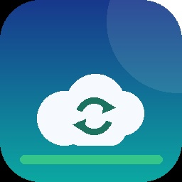

# Switch 云存档同步

[中文](README.md) | **[English](README.en.md)**

> 把 Switch 的**游戏存档**、**相册截图/视频**和**游玩记录**备份到自己的服务器，也能从服务器恢复存档。
>
> 图形界面 · ZIP 压缩 · 增量去重 · 详细游玩事件 · 中英双语 · 自带管理后台




---

## 目录

- [能做什么](#能做什么)
- [准备工作](#准备工作)
- [快速开始](#快速开始)
- [Switch 应用怎么用](#switch-应用怎么用)
- [管理后台](#管理后台)
- [去重和压缩](#去重和压缩)
- [配置项](#配置项)
- [自己编译](#自己编译)
- [项目结构](#项目结构)
- [常见问题](#常见问题)
- [免责声明](#免责声明)

---

## 能做什么

| 功能 | 说明 |
| --- | --- |
| 备份存档 | 打包成标准 ZIP（deflate）上传，PC 上也能直接解压查看 |
| 恢复存档 | 选择服务器上的时间点，校验后写回本机 |
| 只传变化 | 用存档 `commit_id` 预判 + ZIP 内容 SHA-256 确认，没变化直接跳过 |
| 备份相册 | 截图 / 视频增量上传，按 `路径 + 大小 + 修改时间` 判断 |
| 游玩记录 | 汇总（每游戏×用户累计时长）+ 详细事件（启动/关闭/焦点/账号切换） |
| 管理后台 | 设备、存档（含历史版本）、相册预览、时长柱状图、事件柱状图 |
| 首次对接 | 服务端自动显示 API 地址和短令牌，检测到客户端后设置管理员 |
| 中英双语 | 跟随系统语言，或在设置里手动切换 中文 / English |

---

## 准备工作

1. 一台装了 **大气层（Atmosphère）** 的 Switch，能从 hbmenu 运行自制程序
2. 一台电脑（Windows / Linux / macOS），用来跑服务端
3. Switch 和电脑在**同一个 Wi-Fi / 局域网**

服务端只需要 **Python 3.10+**，不用安装任何第三方包。

---

## 快速开始

### 第 1 步：启动服务端（电脑）

```bash
python server/switchcloud_server.py --host 0.0.0.0 --port 8420
```

Windows 也可以直接双击 `server/start.bat`。

启动后终端会打印管理地址和访问令牌，例如：

```
管理页面 : http://127.0.0.1:8420/
对接地址 : http://192.168.1.10:8420
访问令牌 : K7M2-9QX4
```

### 第 2 步：打开管理页面

浏览器访问 **`http://192.168.1.10:8420/`**（换成你电脑的局域网 IP）。

第一次打开是「初次设置」，页面上会显示：

- **服务器地址**：填进 Switch 的地址
- **访问令牌**：短令牌，形如 `K7M2-9QX4`；**不区分大小写，横线可省略**
- 状态：等待客户端连接…

> 不要在向导里用 `127.0.0.1` 给 Switch 填地址，Switch 访问不到本机回环地址。

### 第 3 步：安装 Switch 应用

1. 下载 `switch-cloud-sync.nro`（Releases，或 GitHub Actions 的构建产物）
2. 复制到 SD 卡：`sd:/switch/switch-cloud-sync.nro`
3. 从 hbmenu 启动（推荐按住 `R` 启动任意游戏进入 hbmenu，全内存模式）

### 第 4 步：让两边对接

1. Switch 应用 → **Settings / 设置**
2. 填：
   - Server URL / 服务器地址：`http://192.168.1.10:8420`
   - Access token / 访问令牌：页面上的令牌
3. 保存 → 点 **Test server connection / 测试服务器连接**
4. 电脑上的向导会自动变成「已检测到客户端」，解锁管理员表单

### 第 5 步：设置管理员

在向导第 3 步设置用户名和密码，创建后自动登录管理后台。

### 第 6 步：上传

Switch 首页点 **“一键上传全部 / Upload everything”**：

- 存档 → 相册 → 游玩记录
- 结束后显示上传 / 跳过 / 失败数量
- 第二次运行会大量显示「跳过（未变化）」

---

## Switch 应用怎么用

首页 7 个按钮：

| 按钮 | 作用 |
| --- | --- |
| 一键上传全部 | 存档 + 相册 + 游玩记录 |
| 上传存档 | 只传有变化的存档 |
| 恢复存档 | 列出服务器备份，选择时间点写回 |
| 上传相册 | 新增/变化的截图与视频 |
| 上传游玩记录 | 汇总 + 详细事件 |
| 设置 | 服务器、令牌、语言、同步选项 |
| 退出 | 返回 hbmenu |

按键：

| 按键 | 作用 |
| --- | --- |
| `↑ ↓ ← →` | 移动 |
| `A` | 确认 / 编辑 |
| `B` | 返回 / 取消传输 |
| `X`（设置） | 保存 |
| `Y`（设置） | 重新读取配置 |
| `+` | 退出 |

进度页按 `B` 可以取消；日志同时写入 `sd:/switch/cloud-sync/logs/sync.log`。

### 语言

设置里的 **Language / 语言**：

- `Auto`：跟随 Switch 系统语言（中文系统显示中文，其他显示英文）
- `Chinese` / `English`：强制指定

---

## 管理后台

| 页面 | 内容 |
| --- | --- |
| 概览 | 设备数、存档数/大小、相册数/大小、总时长、最近上传、Top 时长 |
| 设备 | 每台设备的 IP、客户端版本、首次/最近连接时间 |
| 存档 | 按游戏列出，支持查看历史版本和下载 ZIP |
| 相册 | 图片缩略图、视频在线播放、按日期浏览、下载 |
| 游玩时长 | **Top 15 游戏柱状图**、按用户柱状图、完整表格 |
| 游玩事件 | **用户总时长 / 游戏时长 / 事件类型柱状图**，可查看单游戏每次启动/关闭事件，以及最近 14 天游玩柱状图 |
| 对接设置 | 显示/复制对接地址和令牌、重置令牌、修改管理员密码 |

数据都在 `server/data/`（SQLite + 文件），备份这个目录即可。

---

## 去重和压缩

**存档**

1. 读存档的 `commit_id`，和上次一致 → 跳过，连存档都不挂载
2. 否则打包成 ZIP 并算 SHA-256，和上次一致 → 跳过
3. 只有内容变化才上传

**相册**

按 `路径 + 大小 + 修改时间` 判断，没变化不上传；默认不会删除本地文件。

**换了服务器**

客户端会比对服务器的实例 ID。如果服务端数据库被重建（或换了后端），下一次上传会自动重建本地索引，完整上传一次，不会“以为传过了”。

---

## 配置项

在应用内「设置」里改，或手动编辑 `sd:/switch/cloud-sync/config.ini`：

```ini
[server]
base_url = http://192.168.1.10:8420
token = K7M2-9QX4
ca_bundle =
insecure_tls = 0
timeout_sec = 60

[device]
id =
name = my-switch

[saves]
enabled = 1
games_only = 1
max_upload_mb = 256

[sync]
only_changed = 1

[album]
enabled = 1
delete_after_upload = 0

[playtime]
enabled = 1
detailed = 1

[app]
language = auto
```

- `base_url` 不要带结尾 `/`
- 自签 HTTPS：把 PEM 放到 `sd:/switch/cloud-sync/ca-bundle.pem`
- `only_changed = 0` 可以强制全量上传
- 单存档上限按**压缩后**大小计算

---

## 自己编译

需要 devkitPro（devkitA64 + libnx）、`switch-curl`、`switch-freetype`、`switch-harfbuzz`、`switch-zlib`：

```bash
pacman -S --needed switch-dev switch-curl switch-freetype switch-harfbuzz switch-zlib
make -j$(nproc)
```

产物：`switch-cloud-sync.nro`（图标由根目录 `icon.jpg` 自动打包）。

也可以直接用仓库自带的 GitHub Actions 构建，push 后到 Actions 页面下载 artifact。

---

## 项目结构

```
Makefile / icon.jpg
include/               # C++ 头文件（UI、同步、i18n、网络、存档…）
source/                # 对应实现
server/                # 自托管服务端（Python 标准库）
  switchcloud_server.py
  store.py
  webui.py
  start.bat
  README.md
tools/
  dev_server.py        # 更小的联调用后端（只有 API）
  dev_smoke_test.py    # 接口自测
  make_icon.py         # 生成图标
docs/
  API.md               # 服务端协议（自己写后端看这个）
  INSTALL.md           # 构建 / 安装
  TROUBLESHOOTING.md   # 排错
```

---

## 常见问题

**Q：向导一直显示“等待客户端连接”？**
检查 Switch 里填的是不是电脑的**局域网 IP**（不是 127.0.0.1）、端口一致、Windows 防火墙允许 Python 的入站连接。

**Q：上传很慢？**
存档会先压缩；日志里会显示 `压缩 A → B`。相册视频一般是原始大小，首次上传会比较久。

**Q：游戏时长是哪来的？**
来自系统 Play Log（`pdm:qry`），和系统“用户页”同源，不是本应用计时。系统日志是环形缓冲，旧记录会被覆盖。

**Q：恢复后游戏里没有进度？**
游戏必须在恢复**之后**启动；恢复前请完全关闭游戏。服务端建议保留历史版本。

**Q：某个游戏备份失败？**
把 `sd:/switch/cloud-sync/logs/sync.log` 里对应那一行发到 Issues。日志包含路径、条目类型和错误码；拼接文件（concatenation file）已自动处理。

**Q：可以公网访问吗？**
可以，但请放在 HTTPS 反向代理后面，并使用更长的令牌：`--token-length 24`。
详细说明见 [server/README.md](server/README.md)。

更多见 [docs/TROUBLESHOOTING.md](docs/TROUBLESHOOTING.md)。

---

## 免责声明

- 本项目与任天堂无关，未获得任天堂认可或授权。
- 仅用于备份**自己的**存档和个人媒体；请遵守当地法律与任天堂服务条款，风险自负。
- 恢复存档会覆盖本地进度，请自行确认并在服务端保留历史版本。

## 致谢

- [devkitPro](https://devkitpro.org/) / [libnx](https://github.com/switchbrew/libnx)
- [zlib](https://zlib.net/) / [minizip](https://github.com/zlib-ng/minizip-ng)
- [FreeType](https://freetype.org/)
- [NX-Activity-Log](https://github.com/tallbl0nde/NX-Activity-Log)（游玩记录格式参考）
- [JKSV](https://github.com/J-D-K/JKSV)（存档备份与拼接文件处理思路参考）

## License

[MIT](LICENSE)
